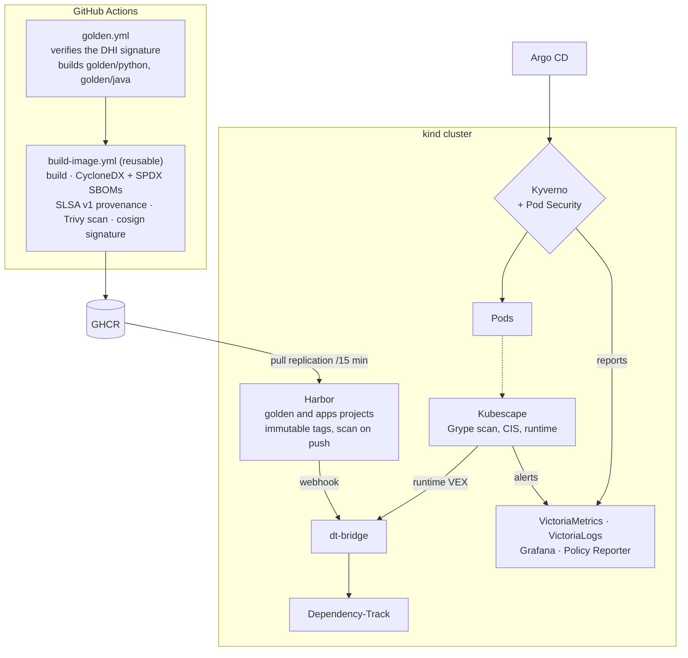

# Architecture

harbor-lab is an image factory and a governance platform. Applications are mere **consumers**: they provide a Dockerfile that starts from a golden image, and a one-line workflow that calls the platform's build workflow. Everything that makes an image trustworthy belongs to the platform.

!!! tip "Vocabulary"
    - **Golden image**: an in-house base image, approved and maintained by the platform (Python and Java here).
    - **SBOM** (*Software Bill of Materials*): the list of an image's components, like an ingredient list.
    - **SLSA provenance**: a signed document stating how, where and from what the image was built.
    - **Attestation**: a document (SBOM, provenance) signed and attached to the image.
    - **VEX**: a statement saying "this CVE is present but does not affect us, for this reason".
    - **Admission**: the check Kubernetes applies when a pod is created; it can reject it.

## The path of an image

1. **Golden images** (`images/golden/<name>`): a thin layer on top of a Docker Hardened Image, adding governance labels and a non-root user. Before the build, the signature of the `dhi.io` base is verified against a **public key pinned in the repository**. `images/catalog.yaml` is the single source of truth: name, version, digest, status (`supported`, `deprecated`, `eol`) and dates. The Kyverno parameters and the catalog page are generated from it, and CI fails if they drift.
2. **Build** through `.github/workflows/build-image.yml`: Buildx build, SBOMs in CycloneDX and SPDX (syft), a SLSA v1 provenance recording the base image digest, push to GHCR, a Trivy scan that applies the VEX published with the base and **only blocks on fixable critical CVEs**, then keyless cosign signing and attestations with the workflow's GitHub OIDC identity.
3. **Harbor** replicates GHCR into its `golden` and `apps` projects every 15 minutes, signatures included. Immutable tags, retention, scan on every push. Its configuration is OpenTofu code (`tofu/harbor`, see [ADR 0005](decisions/0005-opentofu-goharbor.md)). Harbor is also a proxy cache for `docker.io`, `quay.io`, `ghcr.io`, `registry.k8s.io` and `dhi.io`, behind transparent containerd mirrors ([ADR 0006](decisions/0006-miroir-transparent-niveaux-confiance.md)).
4. **Admission**: Kyverno policies written in CEL ([ADR 0002](decisions/0002-kyverno-cel.md)) plus Kubernetes' native Pod Security Admission, applied according to the namespace's trust tier (see [threat model](modele-de-menace.md)).
5. **Vulnerability triage**: every image pushed or replicated into Harbor triggers a webhook to `dt-bridge`. This small service verifies the attestation signatures, sends Dependency-Track **the SBOM attested at build time** (not a regenerated one), then converts the base image's OpenVEX into CycloneDX VEX, the only format Dependency-Track accepts ([ADR 0004](decisions/0004-dependency-track-dt-bridge.md)). If the provenance fails verification, no SBOM is sent.
6. **Runtime**: the Kubescape operator scans running images with Grype, checks CIS/NSA controls, raises alerts when a container departs from its profile, and produces runtime VEX that `dt-bridge` forwards to Dependency-Track ([ADR 0003](decisions/0003-kubescape.md)).
7. **Observability**: VictoriaMetrics scrapes `dt-bridge`'s posture metrics, VictoriaLogs collects every log (Kubescape alerts and the API server audit log included), Grafana shows the *image posture* dashboard, Policy Reporter lists Kyverno reports.

## Cluster building blocks

| Layer | Component | Why this choice |
|---|---|---|
| Cluster | kind, single node, containerd mirrors to Harbor | Reproducible on a workstation, no cloud account |
| Network | Cilium (replaces kube-proxy), Gateway API on the host network, `*.127.0.0.1.nip.io` | Same CNI as in production on Taloslab, L3-L7 network policies |
| GitOps | Argo CD, `root` app of apps, waves 0 to 4 | The whole cluster state comes from Git, in a controlled order |
| PKI | Local CA generated by `task up`, cert-manager, trust-manager | The CA is never committed; trust-manager distributes it to namespaces |
| Secrets | OpenBao (Kubernetes auth, one policy per consumer) + External Secrets | No secret in Git, nor in plain OpenTofu state |
| Databases | CloudNativePG, one instance for Harbor, one for Dependency-Track | Standard PostgreSQL operator |
| Registry | Harbor 2.15, configured by OpenTofu (`goharbor/harbor` provider) | The most common open source registry in enterprises |
| Admission | Kyverno ≥ 1.19 (CEL policies) + Pod Security Admission | See [ADR 0002](decisions/0002-kyverno-cel.md) |
| Triage | Dependency-Track 5.1 + `dt-bridge` | See [ADR 0004](decisions/0004-dependency-track-dt-bridge.md) |
| Runtime | Kubescape operator | See [ADR 0003](decisions/0003-kubescape.md) |
| Observability | metrics-server, VictoriaMetrics, VictoriaLogs, Grafana, Policy Reporter | Lightweight, fits the memory budget |

Argo CD syncs the Applications wave by wave, each wave waiting for the previous one to be healthy:

| Wave | Content |
|---|---|
| 0 | Operators and OpenBao |
| 1 | trust-manager and platform configuration (local CA) |
| 2 | Kyverno, Harbor, Dependency-Track |
| 3 | Kyverno policies, Kubescape, observability |
| 4 | Workloads |

**No workload exists before admission is in place.** That is the invariant the wave order protects.

## Trust tiers

| Tier | Namespaces | What admission requires |
|---|---|---|
| Workload | label `harborlab.io/tier=workload` | Enforced: signature and attestations from the build workflow, catalog base, labels, Harbor `golden`/`apps` only, Pod Security `restricted`, digest reference |
| Platform | label `harborlab.io/tier=platform` | Reported only (`Audit` mode): registry in an allow-list, vendor signatures |
| Bootstrap | `kube-system`, `cilium`, `argocd`, `kyverno` | Excluded by name (see [threat model](modele-de-menace.md#bootstrap-namespaces-an-accepted-exclusion)) |
| None | any other namespace | Every pod denied (`tier-required`): a forgotten label never turns the checks off |

## Workloads

| Workload | Role |
|---|---|
| `dt-bridge` (Python, FastAPI) | Harbor → Dependency-Track webhook, Kubescape VEX forwarding, posture metrics. Itself built through the golden path |
| `hello-java` (Spring Boot) | Second golden path consumer, on the Java base |
| `runtime-demo` | Target of the runtime and admission demos: a governed image that includes a shell, with a hand-written Kubescape profile |

## Repository layout

| Path | Content |
|---|---|
| `images/` | Golden image Dockerfiles and `catalog.yaml` |
| `apps/` | Application sources, each built by a one-line workflow |
| `.github/workflows/` | `build-image.yml` (reusable), golden, application, fixture, policy and platform CI workflows |
| `platform/` | kind, bootstrap Helm values, Argo CD Applications, platform manifests |
| `policies/` | Kyverno policies and their generated parameters |
| `tofu/harbor/` | Harbor configuration in OpenTofu |
| `scripts/` | Implementation of the Taskfile tasks |
| `tests/` | bats, `kyverno test` and Chainsaw suites |
