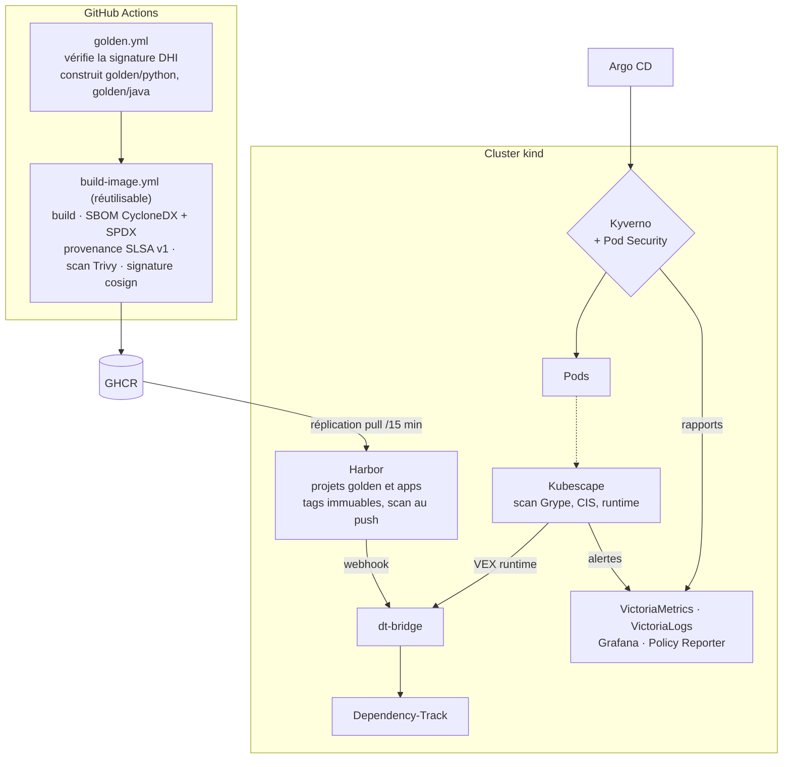

# Architecture

harbor-lab est une usine à images doublée d'une plateforme de gouvernance. Les applications sont de simples **consommatrices** : elles fournissent un Dockerfile qui part d'une image golden, et un workflow d'une ligne qui appelle le workflow de build de la plateforme. Tout ce qui rend une image digne de confiance appartient à la plateforme.

!!! tip "Vocabulaire"
    - **Image golden** : image de base maison, validée et maintenue par la plateforme (ici Python et Java).
    - **SBOM** (*Software Bill of Materials*) : la liste des composants d'une image, comme une liste d'ingrédients.
    - **Provenance SLSA** : un document signé qui dit comment, où et à partir de quoi l'image a été construite.
    - **Attestation** : un document (SBOM, provenance) signé et attaché à l'image.
    - **VEX** : une déclaration « cette CVE est présente mais ne nous concerne pas, pour telle raison ».
    - **Admission** : le contrôle que Kubernetes applique au moment où un pod est créé ; il peut refuser.

## Le trajet d'une image

1. **Images golden** (`images/golden/<nom>`) : une couche fine au-dessus d'une Docker Hardened Image. On y ajoute les labels de gouvernance et un utilisateur non-root. Avant le build, la signature de l'image de base `dhi.io` est vérifiée contre une **clé publique épinglée dans le dépôt**. Le fichier `images/catalog.yaml` est la source unique de vérité : nom, version, digest, statut (`supported`, `deprecated`, `eol`) et dates. Les paramètres Kyverno et la page catalogue en sont générés, et la CI échoue s'ils divergent.
2. **Build** via `.github/workflows/build-image.yml` : build Buildx, SBOM en CycloneDX et en SPDX (syft), provenance SLSA v1 qui enregistre le digest de l'image de base, push sur GHCR, scan Trivy qui applique les VEX publiés avec la base et **ne bloque que sur les CVE critiques corrigeables**, puis signature et attestations cosign *keyless* avec l'identité OIDC GitHub du workflow.
3. **Harbor** réplique GHCR vers ses projets `golden` et `apps` toutes les 15 minutes, signatures comprises. Tags immuables, rétention, scan à chaque push. Sa configuration est du code OpenTofu (`tofu/harbor`, voir [ADR 0005](decisions/0005-opentofu-goharbor.md)). Harbor sert aussi de cache proxy pour `docker.io`, `quay.io`, `ghcr.io`, `registry.k8s.io` et `dhi.io`, derrière des miroirs containerd transparents ([ADR 0006](decisions/0006-miroir-transparent-niveaux-confiance.md)).
4. **Admission** : des policies Kyverno écrites en CEL ([ADR 0002](decisions/0002-kyverno-cel.md)) et le Pod Security Admission natif de Kubernetes, appliqués selon le niveau de confiance du namespace (voir [modèle de menace](modele-de-menace.md)).
5. **Tri des vulnérabilités** : chaque image poussée ou répliquée dans Harbor déclenche un webhook vers `dt-bridge`. Ce petit service vérifie les signatures des attestations, envoie à Dependency-Track **le SBOM attesté au build** (pas un SBOM régénéré), puis convertit les VEX OpenVEX de l'image de base en VEX CycloneDX, seul format que Dependency-Track accepte ([ADR 0004](decisions/0004-dependency-track-dt-bridge.md)). Si la provenance ne se vérifie pas, aucun SBOM n'est envoyé.
6. **Runtime** : l'opérateur Kubescape scanne les images en cours d'exécution avec Grype, vérifie les contrôles CIS/NSA, lève des alertes quand un conteneur s'écarte de son profil, et produit des VEX runtime que `dt-bridge` transmet à Dependency-Track ([ADR 0003](decisions/0003-kubescape.md)).
7. **Observabilité** : VictoriaMetrics collecte les métriques de posture de `dt-bridge`, VictoriaLogs collecte tous les logs (alertes Kubescape et audit log de l'API server compris), Grafana affiche le tableau de bord *image posture*, Policy Reporter liste les rapports Kyverno.

## Les briques du cluster

| Couche | Composant | Pourquoi ce choix |
|---|---|---|
| Cluster | kind, un seul nœud, miroirs containerd vers Harbor | Reproductible sur un poste, sans compte cloud |
| Réseau | Cilium (remplace kube-proxy), Gateway API sur le réseau de l'hôte, `*.127.0.0.1.nip.io` | Même CNI qu'en production sur Taloslab, policies réseau L3-L7 |
| GitOps | Argo CD, app-of-apps `root`, vagues 0 à 4 | Tout l'état du cluster vient de Git, dans un ordre maîtrisé |
| PKI | CA locale générée par `task up`, cert-manager, trust-manager | Le CA n'est jamais commité ; trust-manager le distribue aux namespaces |
| Secrets | OpenBao (auth Kubernetes, une policy par consommateur) + External Secrets | Aucun secret dans Git, ni dans l'état OpenTofu en clair |
| Bases de données | CloudNativePG, une instance pour Harbor, une pour Dependency-Track | Opérateur PostgreSQL standard |
| Registre | Harbor 2.15, configuré par OpenTofu (provider `goharbor/harbor`) | Registre open source le plus répandu en entreprise |
| Admission | Kyverno ≥ 1.19 (policies CEL) + Pod Security Admission | Voir [ADR 0002](decisions/0002-kyverno-cel.md) |
| Tri | Dependency-Track 5.1 + `dt-bridge` | Voir [ADR 0004](decisions/0004-dependency-track-dt-bridge.md) |
| Runtime | Opérateur Kubescape | Voir [ADR 0003](decisions/0003-kubescape.md) |
| Observabilité | metrics-server, VictoriaMetrics, VictoriaLogs, Grafana, Policy Reporter | Léger, tient dans le budget mémoire |

Argo CD synchronise les Applications par vague, chaque vague attendant que la précédente soit saine :

| Vague | Contenu |
|---|---|
| 0 | Opérateurs et OpenBao |
| 1 | trust-manager et configuration de la plateforme (CA locale) |
| 2 | Kyverno, Harbor, Dependency-Track |
| 3 | Policies Kyverno, Kubescape, observabilité |
| 4 | Workloads |

**Aucun workload n'existe avant que l'admission ne soit en place.** C'est l'invariant que l'ordre des vagues protège.

## Niveaux de confiance

| Niveau | Namespaces | Ce que l'admission exige |
|---|---|---|
| Workload | label `harborlab.io/tier=workload` | Bloquant : signature et attestations du workflow de build, base au catalogue, labels, Harbor `golden`/`apps` uniquement, Pod Security `restricted`, référence en digest |
| Plateforme | label `harborlab.io/tier=platform` | Signalé seulement (mode `Audit`) : registre dans une liste autorisée, signatures éditeur |
| Bootstrap | `kube-system`, `cilium`, `argocd`, `kyverno` | Exclus nommément (voir [modèle de menace](modele-de-menace.md#namespaces-de-bootstrap-une-exclusion-assumee)) |
| Aucun | tout autre namespace | Tout pod refusé (`tier-required`) : un label oublié ne désactive jamais les contrôles |

## Workloads

| Workload | Rôle |
|---|---|
| `dt-bridge` (Python, FastAPI) | Webhook Harbor → Dependency-Track, transfert des VEX Kubescape, métriques de posture. Construit lui-même par le golden path |
| `hello-java` (Spring Boot) | Deuxième consommateur du golden path, sur la base Java |
| `runtime-demo` | Cible des démos runtime et admission : image gouvernée qui contient un shell, avec un profil Kubescape écrit à la main |

## Organisation du dépôt

| Chemin | Contenu |
|---|---|
| `images/` | Dockerfiles des images golden et `catalog.yaml` |
| `apps/` | Sources des applications, chacune construite par un workflow d'une ligne |
| `.github/workflows/` | `build-image.yml` (réutilisable), workflows golden, applications, fixtures, policies, CI plateforme |
| `platform/` | kind, valeurs Helm de bootstrap, Applications Argo CD, manifestes de la plateforme |
| `policies/` | Policies Kyverno et leurs paramètres générés |
| `tofu/harbor/` | Configuration Harbor en OpenTofu |
| `scripts/` | Implémentation des tâches du Taskfile |
| `tests/` | Suites bats, `kyverno test` et Chainsaw |
