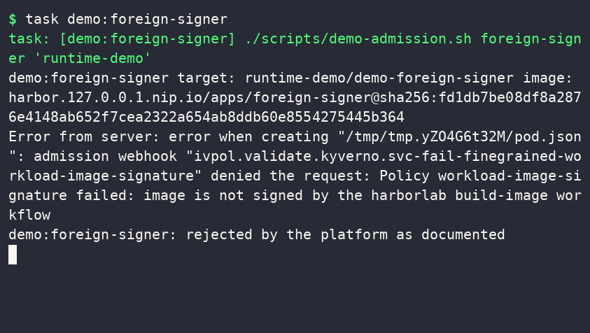
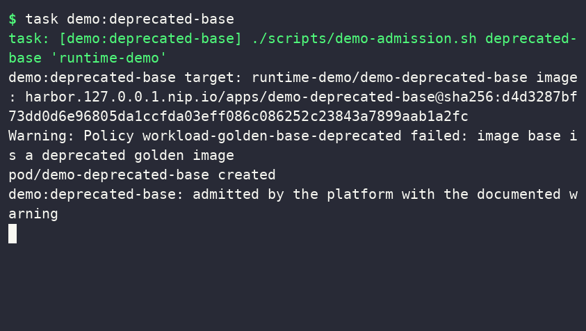
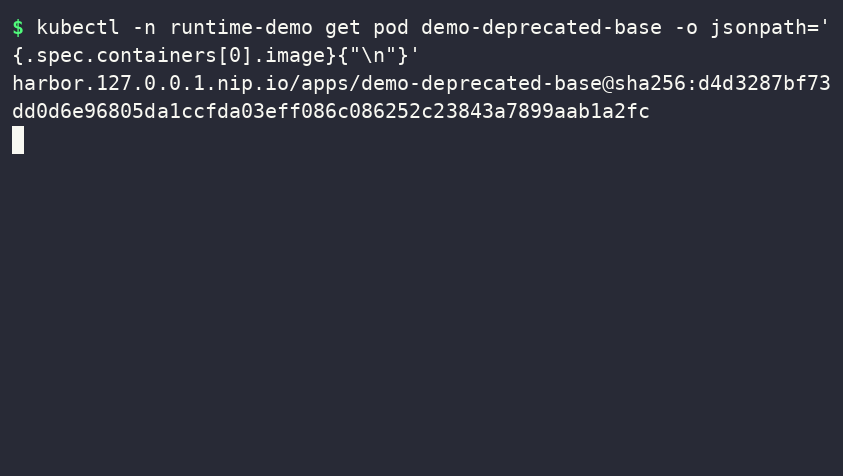
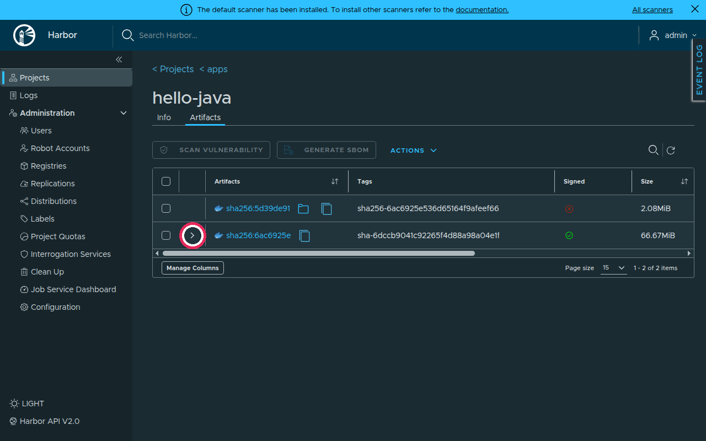
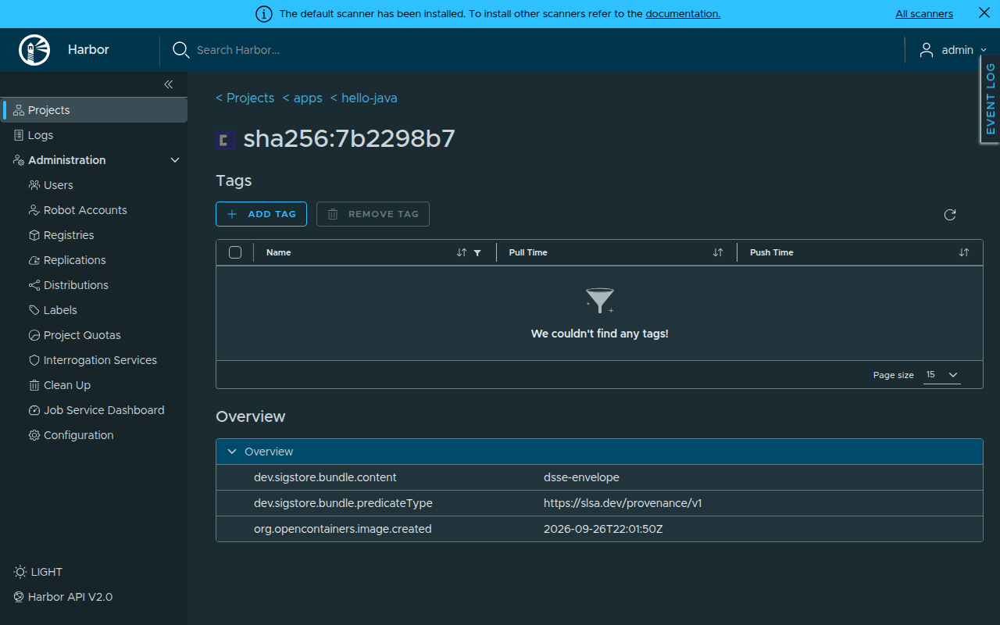
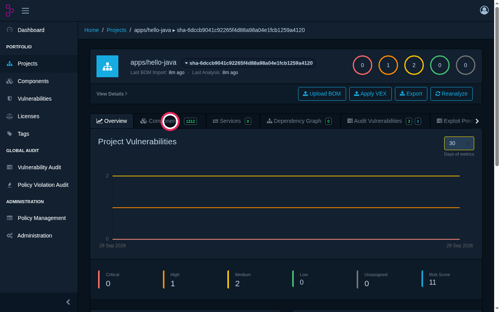
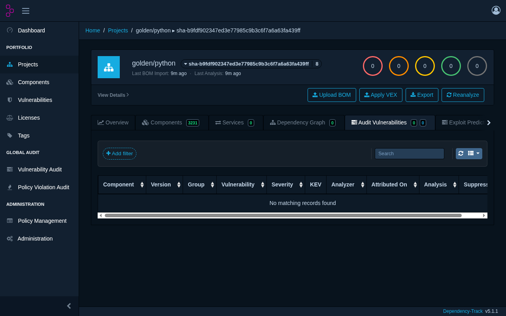
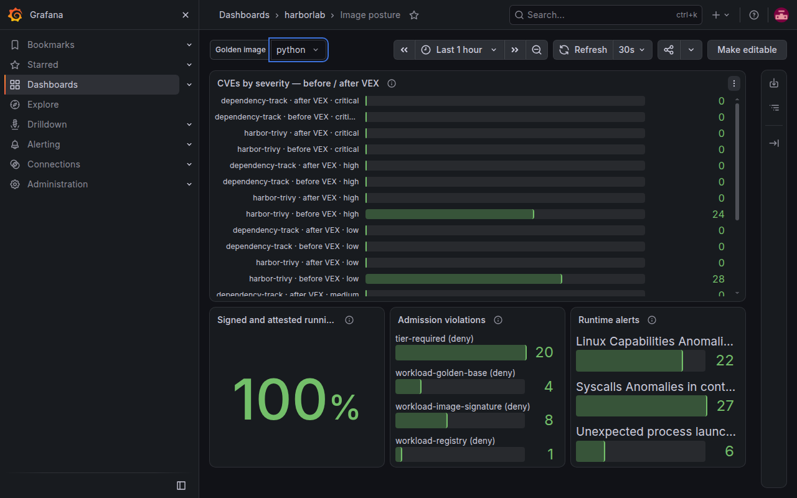
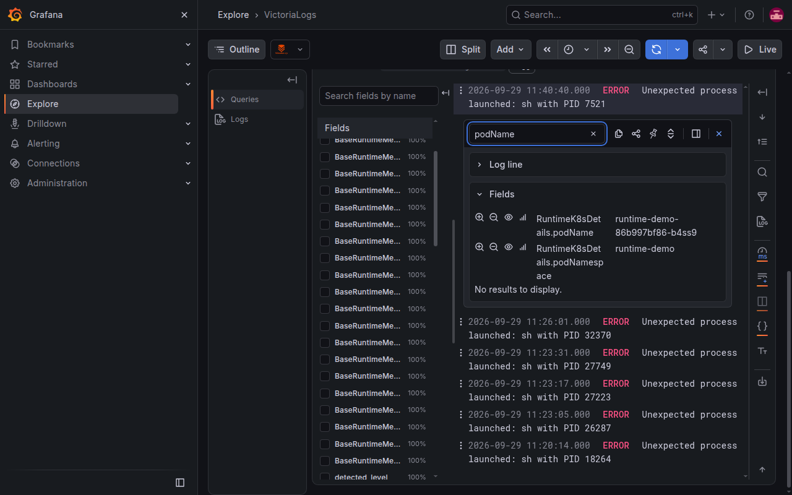
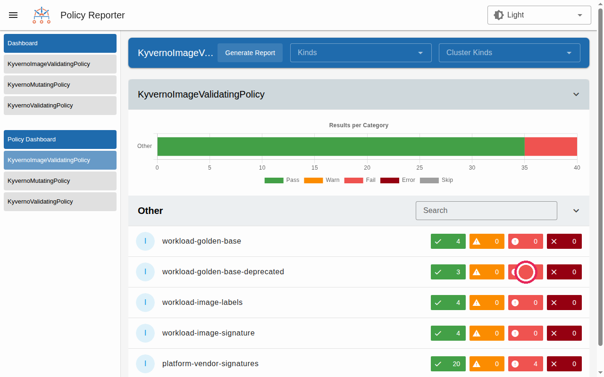

# Demo

Nine scenarios show the platform reacting. Each one is a Taskfile task, run on a started platform. A task only succeeds if it **has observed** the expected reaction, not merely submitted something. The exact commands are in the [harbor-lab README](https://github.com/naqa92-portfolio-projects/harbor-lab#readme) and the [Taskfile](https://github.com/naqa92-portfolio-projects/harbor-lab/blob/main/Taskfile.yml).

## What each scenario proves

### At admission: what does not get in

| Scenario | What is submitted | Reaction | What it proves |
|---|---|---|---|
| `demo:unsigned` | A compliant image, copied without any signature | Denied by `workload-image-signature` | Nothing gets in without a signature |
| `demo:foreign-signer` | The same image, signed and attested by **another identity** than the build workflow | Same denial | A valid signature from the wrong identity is worth nothing |
| `demo:non-golden-base` | An image built directly on a DHI image, outside the catalog | Denied by `workload-golden-base` | The base is read from the signed provenance, not from a declarative label |
| `demo:eol-base` | An image built on Java 26, marked `eol` in the catalog | Denied by `workload-golden-base` | The base lifecycle is enforced automatically |
| `demo:direct-dockerhub` | `busybox` pulled straight from Docker Hub | Denied by `workload-registry` | Even if the node goes through the Harbor cache, the reference must name Harbor |
| `demo:root` | A governed image, but a pod running as root | Denied by Pod Security `restricted` | The image chain does not replace pod security |

### At admission: what gets in, under conditions

| Scenario | What is submitted | Reaction | What it proves |
|---|---|---|---|
| `demo:deprecated-base` | An image built on Python 3.10, marked `deprecated` | **Admitted with a warning**, image rewritten to a digest | A team can be given time to migrate without being blocked, while keeping it visible |

Run in a namespace without a tier label, any scenario is denied by `tier-required`: that is intended, a forgotten namespace must never escape the checks.

### At runtime

| Scenario | What is done | Reaction | What it proves |
|---|---|---|---|
| `demo:runtime-shell` | Open a shell in a running governed container | Kubescape alert `Unexpected process launched` within seconds, visible in Grafana | Governance does not stop at admission |
| `demo:vex` | Replay the Harbor event of a golden image | Dependency-Track receives the attested SBOM and accepts the vendor VEX (`COMPLETED`) | Triage runs on what was signed at build time |

!!! warning "Accepted limit"
    The `demo:vex` scenario proves that the VEX is accepted and processed, **not** that every Debian flaw shows as "not affected". Dependency-Track does not yet match Debian source and binary packages (upstream bug). See [Known limits](limites.md).

## Recorded walkthroughs

Three walkthroughs were recorded on the platform, with 20 Argo CD Applications synced and healthy.

### P1 — Watch the platform reject a non-compliant image

The seven admission scenarios chained in a terminal.

<video controls width="100%" src="../../assets/demo/P1.mp4"></video>

### P2 — Follow an image from the golden path to CVE triage

In Harbor, the `hello-java` image is signed and carries four accessories: the signature, two SBOMs and the provenance.

The provenance accessory has the type `https://slsa.dev/provenance/v1`. Harbor shows them all as `signature.cosign`, a known display limit.

In Dependency-Track, the `hello-java` project lists 1,312 components, those of the SBOM attested at build time.

For `golden/python`, no Debian CVE is listed: that is the upstream limit described above, not an absence of flaws.

### P3 — Spot a shell in a container from Grafana

The *image posture* dashboard shows CVEs by severity before and after VEX, with their source, the share of signed and attested running images, admission denials and runtime alerts.

In VictoriaLogs, the Kubescape event names the pod targeted by the demo.

In Policy Reporter, the deprecated base shows as `fail` rather than `warn`: a limit of CEL policies, documented in [ADR 0002](decisions/0002-kyverno-cel.md).

