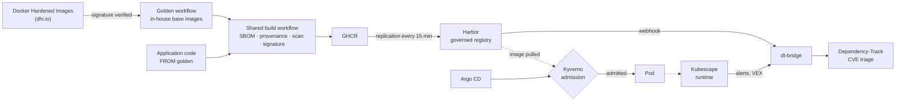

# harbor-lab

**A platform that decides which container images may run on a Kubernetes cluster, and proves it.**

An application team writes two lines: `FROM <golden image>` in its Dockerfile and one `uses:` pointing to the platform's build workflow. The platform owns everything else: building the image, signing it, listing its components, replicating it into the registry, letting it into the cluster (or not), watching what it does once running, and triaging its vulnerabilities.

!!! info "For a recruiter, in 30 seconds"
    - **The problem**: in a bank or any regulated company, you must be able to answer "where does this container come from, who built it, on which base, with which known flaws?" for every pod in production.
    - **The answer**: an end-to-end chain of trust, from the base image to cluster admission, fully declared in Git and tested automatically.
    - **The proof**: nine demo scenarios showing the platform reject an unsigned image, an image signed by someone else, one built on an outdated base, one pulled straight from Docker Hub, or one running as root. See [Demo](demo.md).

## What talks to what

Everything runs on **a single local [kind](https://kind.sigs.k8s.io/) cluster**: anyone with 16 GiB of RAM must be able to run the project again, without a cloud account.

## Key figures

| | |
|---|---|
| Components deployed by Argo CD | 19 Applications, in 5 sync waves |
| Kyverno admission policies | 10 (6 workload, 2 trust tier, 2 platform) |
| Automated tests | 143 bats tests, 17 Chainsaw scenarios, 8 `kyverno test` suites, 26 pytest tests |
| GitHub Actions workflows | 14 |
| Documented decisions | 8 ADRs |
| Memory budget | ≤ 12 GiB, measured peak 10,708 Mi |
| Full start | about 15 minutes (`task up`) |

## Reading paths

=== "2 minutes"

    1. This page.
    2. The [architecture diagram](architecture.md#the-path-of-an-image): the path of an image.
    3. The first three rows of the [demo](demo.md): what the platform rejects, and why.

=== "10 minutes"

    1. [Architecture](architecture.md): the building blocks and the trust tiers.
    2. [Threat model](modele-de-menace.md): what admission checks, and the accepted exceptions.
    3. Two decisions: [keyless signing](decisions/0007-signature-keyless.md) and [Kyverno CEL](decisions/0002-kyverno-cel.md).
    4. [What broke](incidents.md): upstream bugs worked around and what they taught me.
    5. [Known limits](limites.md): what I do not claim to cover.

## What I would show in a demo

1. `task demo:unsigned` then `task demo:foreign-signer`: an image without a signature is rejected, and so is an image signed by **another identity** than the platform's workflow. A valid signature from the wrong party is worth nothing.
2. `task demo:deprecated-base`: the image is admitted with a warning, and its reference is rewritten to an `@sha256:` digest so a tag can no longer be moved afterwards.
3. `task demo:runtime-shell`: I open a shell in a running container, Kubescape raises an alert within seconds, and I find it in Grafana.
4. In Harbor then Dependency-Track: the `hello-java` image, its signature, SBOMs and provenance, then its component list as attested at build time.

## Stack

Kubernetes (kind) · Cilium · Argo CD · Harbor · Kyverno (CEL) · cosign / Sigstore · syft · Trivy · Kubescape · Dependency-Track · OpenTofu · OpenBao · External Secrets · CloudNativePG · cert-manager · trust-manager · VictoriaMetrics · VictoriaLogs · Grafana · GitHub Actions · Python (FastAPI)

Source code: [naqa92-portfolio-projects/harbor-lab](https://github.com/naqa92-portfolio-projects/harbor-lab).
