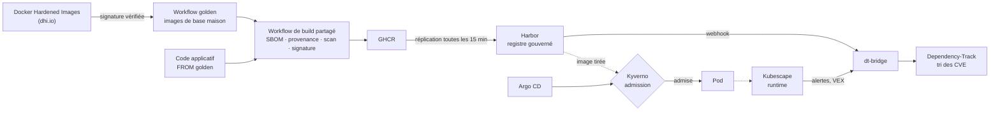

# harbor-lab

**Une plateforme qui décide quelles images de conteneurs ont le droit de tourner sur un cluster Kubernetes, et qui le prouve.**

Une équipe applicative écrit deux lignes : `FROM <image golden>` dans son Dockerfile et un `uses:` vers le workflow de build de la plateforme. Tout le reste appartient à la plateforme : construire l'image, la signer, lister ses composants, la répliquer dans le registre, la laisser entrer (ou non) dans le cluster, surveiller ce qu'elle fait une fois lancée et trier ses vulnérabilités.

!!! info "Pour un recruteur, en 30 secondes"
    - **Le problème** : dans une banque ou une entreprise régulée, on doit pouvoir répondre à « d'où vient ce conteneur, qui l'a construit, sur quelle base, avec quelles failles connues ? » pour chaque pod en production.
    - **La réponse** : une chaîne de confiance de bout en bout, de l'image de base jusqu'à l'admission dans le cluster, entièrement déclarée dans Git et testée automatiquement.
    - **La preuve** : neuf scénarios de démo qui montrent la plateforme refuser une image non signée, signée par un tiers, construite sur une base obsolète, tirée directement de Docker Hub, ou lancée en root. Voir [Démo](demo.md).

## Ce qui parle à quoi

Tout tourne sur **un seul cluster local [kind](https://kind.sigs.k8s.io/)** : le projet doit pouvoir être relancé par n'importe qui avec 16 Gio de RAM, sans compte cloud.

## Chiffres clés

| | |
|---|---|
| Composants déployés par Argo CD | 19 Applications, en 5 vagues de synchronisation |
| Policies d'admission Kyverno | 10 (6 workload, 2 niveaux de confiance, 2 plateforme) |
| Tests automatisés | 143 tests bats, 17 scénarios Chainsaw, 8 suites `kyverno test`, 26 tests pytest |
| Workflows GitHub Actions | 14 |
| Décisions documentées | 8 ADR |
| Budget mémoire | ≤ 12 Gio, pic mesuré à 10 708 Mi |
| Démarrage complet | environ 15 minutes (`task up`) |

## Parcours de lecture

=== "2 minutes"

    1. Cette page.
    2. Le [schéma d'architecture](architecture.md#le-trajet-dune-image) : le trajet d'une image.
    3. Les trois premières lignes de la [démo](demo.md) : ce que la plateforme refuse, et pourquoi.

=== "10 minutes"

    1. [Architecture](architecture.md) : les briques et les niveaux de confiance.
    2. [Modèle de menace](modele-de-menace.md) : ce que l'admission vérifie, et les exceptions assumées.
    3. Deux décisions : [signature keyless](decisions/0007-signature-keyless.md) et [Kyverno CEL](decisions/0002-kyverno-cel.md).
    4. [Ce qui a cassé](incidents.md) : les bugs amont contournés et ce qu'ils m'ont appris.
    5. [Limites connues](limites.md) : ce que je ne prétends pas couvrir.

## Ce que je montrerais en démo

1. `task demo:unsigned` puis `task demo:foreign-signer` : une image sans signature est refusée, et une image signée par **une autre identité** que le workflow de la plateforme l'est aussi. Une signature valide de la mauvaise personne ne vaut rien.
2. `task demo:deprecated-base` : l'image est admise avec un avertissement, et sa référence est réécrite en digest `@sha256:` pour qu'un tag ne puisse plus être déplacé après coup.
3. `task demo:runtime-shell` : j'ouvre un shell dans un conteneur en cours d'exécution, Kubescape lève une alerte en quelques secondes et je la retrouve dans Grafana.
4. Dans Harbor puis Dependency-Track : l'image `hello-java`, sa signature, ses SBOM et sa provenance, puis la liste de ses composants telle qu'attestée au build.

## Stack

Kubernetes (kind) · Cilium · Argo CD · Harbor · Kyverno (CEL) · cosign / Sigstore · syft · Trivy · Kubescape · Dependency-Track · OpenTofu · OpenBao · External Secrets · CloudNativePG · cert-manager · trust-manager · VictoriaMetrics · VictoriaLogs · Grafana · GitHub Actions · Python (FastAPI)

Code source : [naqa92-portfolio-projects/harbor-lab](https://github.com/naqa92-portfolio-projects/harbor-lab).
